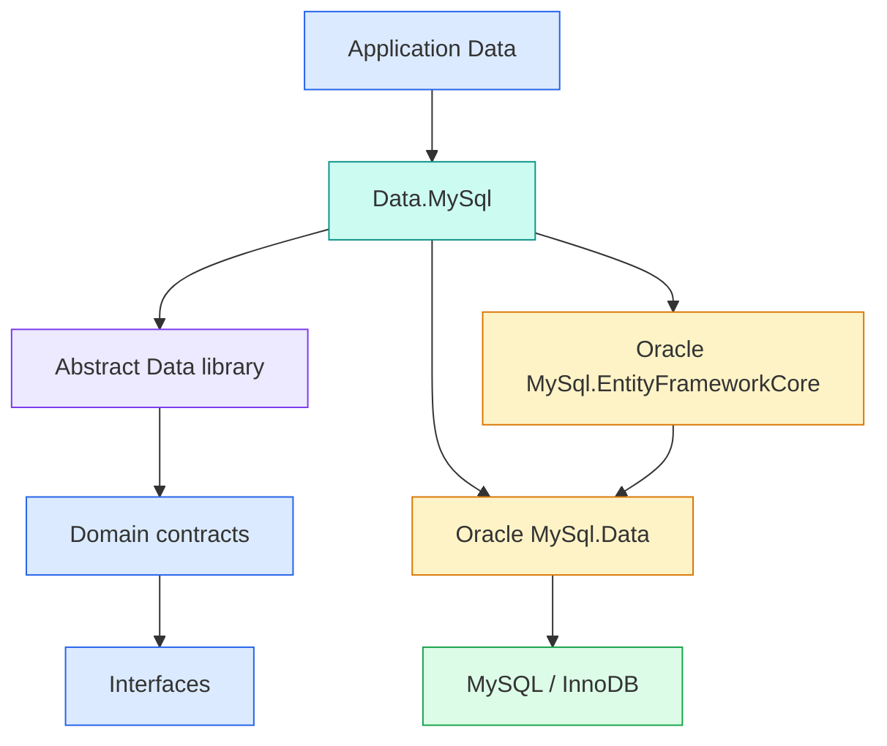

# RFC: MySQL Data Provider

- **RFC ID**: 2026-11-13-mysql-data-provider
- **Jira**: MDPE-12
- **Status**: Implemented
- **Author(s)**: Paradigm maintainers, prepared with Codex
- **Created**: 2026-11-13
- **Last Updated**: 2026-11-13
- **Working branch**: `codex/MDPE-12-mysql-support`
- **Analysis baseline**: local `main` at `1bf9e8c`
- **Implementation authorization**: user approved proceeding on 2026-11-13 with the selected Oracle stack. Use MySQL 8.4/InnoDB for the initial integration baseline, `char(36)` Guid storage, and explicit UTC `datetime(6)` mappings in the test fixture; broader mappings remain application-owned.

## Summary

Add `Paradigm.Enterprise.Data.MySql` as a sibling of the SQL Server and PostgreSQL packages. It will reference `Paradigm.Enterprise.Data` and use its existing context, repository, Unit of Work, transaction, and reader-mapping infrastructure. Applications will retain their existing Domain and Interfaces contracts and select MySQL at the persistence and registration boundaries.

MDPE-12 provides runtime adapter parity: named connections, EF Core registration, CRUD and search through shared repositories, auditing, transactions, typed procedure parameters, and one through sixteen procedure result sets. It includes semantic-check support, packaging, documentation, and real MySQL integration tests. This RFC was prepared before implementation; the implementation record below captures the resulting behavior and validation.

Use Oracle's `MySql.EntityFrameworkCore` **10.0.12**, the latest stable release verified on 2026-11-13, with its matching `MySql.Data` **26.10.0** driver. The provider includes a `net10.0` dependency group requiring EF Core and Relational >= 10.0.12, which admits the checkout's centrally pinned 10.0.15. The provider choice and version are decided; restore, security auditing, and runtime compatibility tests remain implementation gates.

## Motivation

Applications using MySQL currently have to configure EF and implement routine plumbing themselves, or adopt another database. The shared Data layer already supplies the application-facing persistence behavior. A small engine adapter should make that behavior available without duplicating repository hierarchies or introducing MySQL types into Domain, Providers, Interfaces, or HTTP contracts.

“Same functionality” means equivalent framework capabilities under the existing contracts. SQL syntax, database types, cursor mechanics, schema naming, and authentication facilities remain engine-specific. SQL Server-specific exception translation and Azure authentication are not portable contracts.

## Current Implementation Analysis

The current source, rather than historical RFCs, establishes this baseline:

| Area | Existing implementation and consequence |
| --- | --- |
| Context and connections | [DbContextBase<TId>](../../src/Paradigm.Enterprise.Data/Context/DbContextBase.cs) owns audit/save and transaction participation. [DbContextConnectionProvider](../../src/Paradigm.Enterprise.Data/Context/DbContextConnectionProvider.cs) supplies configuration and a disposal extension point; concrete adapters own named connection caches. |
| Repositories | [RepositoryBase](../../src/Paradigm.Enterprise.Data/Repositories/RepositoryBase.cs), [ReadRepositoryBase](../../src/Paradigm.Enterprise.Data/Repositories/ReadRepositoryBase.cs), and [EditRepositoryBase](../../src/Paradigm.Enterprise.Data/Repositories/EditRepositoryBase.cs) implement shared persistence behavior. No MySQL repository base is necessary. |
| Public contracts | Repository and Unit of Work contracts live in [Domain/Repositories](../../src/Paradigm.Enterprise.Domain/Repositories) and [Domain/Uow](../../src/Paradigm.Enterprise.Domain/Uow). Interfaces owns entity and auditing contracts. Identifier constraints remain `where TId : struct, IEquatable<TId>`. |
| Consistency | [UnitOfWork](../../src/Paradigm.Enterprise.Data/Uow/UnitOfWork.cs) saves registered contexts sequentially. [DbContextTransaction](../../src/Paradigm.Enterprise.Data/Uow/DbContextTransaction.cs) enlists compatible contexts and commands sharing the same connection. Saving alone does not make several contexts atomic. |
| Routine execution | Each existing adapter owns `StoredProcedureBase`, `StoredProcedureBase<TParameters>`, and `ResultStoredProcedureBase<TParameters, TResult1, ...>` for one through sixteen results. There is **no shared routine-execution base** in the abstract Data library. |
| Mapping | [DbDataReaderExtensions](../../src/Paradigm.Enterprise.Data/Extensions/DbDataReaderExtensions.cs) and [reader mappers](../../src/Paradigm.Enterprise.Data/StoredProcedures/Mappers) are shared. Parameter mapper interfaces, bases, and factories are provider-specific. |
| Registration | Each provider exposes `RegisterContext<TContext>(IServiceCollection, string connectionStringName)`. The application separately registers a scoped connection provider. Context options use its named connection. |
| Tooling | [PE3103](../../src/Paradigm.Enterprise.Checks.CSharp/Analysis/CSharpChecks.cs) recognizes SQL Server/PostgreSQL typed routine boundaries when diagnosing EF pagination. The common guidance names a PE3107 raw-SQL rule, but no implementation exists in this checkout. [ApiGuideService](../../src/Paradigm.Enterprise.Cli/Metadata/ApiGuideService.cs) names those two engines. Both need MySQL support. |
| Generation | At the analysis baseline, [StoredProcedureMapperGenerator](../../src/Paradigm.Enterprise.CodeGenerator/Generators/StoredProcedureMapperGenerator.cs) hardcoded SQL Server parameter output. MDPE-12 also adds explicit provider-aware generation, including MySQL mappers and registration. |
| Delivery | [Central dependencies](../../src/Directory.Packages.props) pin EF Core 10.0.15. [Shared build properties](../../src/Directory.Build.props) supply release version, MIT metadata, XML docs, and NuGet auditing. |

The existing [provider guide](../data-providers.md) describes the two current adapters. SQL Server uses sequential procedure results; PostgreSQL uses returned cursor names for multiple results. The latter cursor behavior is not a template for MySQL.

At analysis time, no deployed MySQL version, schema, workload, cardinalities, or production environment was supplied. MySQL 8.4 with InnoDB was proposed and accepted as the initial test and support baseline for this implementation. It is not an observed production deployment constraint. No query tuning or performance improvement has been measured.

## Detailed Design

### Scope and Ownership



The new project belongs at `src/Paradigm.Enterprise.Data.MySql` and directly references the abstract Data project. It has no reference to either sibling adapter. Shared Data remains free of MySQL dependencies. Application contexts continue deriving from `DbContextBase<TId>`; repositories continue deriving from the existing generic bases.

MDPE-12 includes runtime adapter parity, provider-aware parameter/reader mapper generation, and the supporting checks, tests, package integration, and documentation. `generate mappers --database-provider mysql` selects Oracle MySQL; `sqlserver` remains the default, and `postgresql` selects the existing PostgreSQL adapter. Database-first EF scaffolding is exercised as a provider compatibility smoke test. Database schema publishing, Aspire hosting/bootstrap packages, Visual Studio template changes, MariaDB certification, and managed-cloud authentication recipes remain separate follow-up work. Existing runtime SQL Server/PostgreSQL contracts keep their current behavior.

### Selected Provider and Compatibility Validation

As checked on 2026-11-13:

| Component | Selected version | Evidence |
| --- | --- | --- |
| Oracle `MySql.EntityFrameworkCore` | **10.0.12** | [Versioned NuGet metadata](https://www.nuget.org/packages/MySql.EntityFrameworkCore/10.0.12) lists a stable release with a `net10.0` group requiring EF Core/Relational >= 10.0.12 and `MySql.Data` >= 26.10.0. |
| Oracle `MySql.Data` | **26.10.0** | [Versioned driver metadata](https://www.nuget.org/packages/MySql.Data/26.10.0) supplies the matching Connector/NET release and its `net10.0` dependencies. |
| Shared EF Core and Relational | **10.0.15**, unchanged | The existing central versions satisfy the selected provider's declared lower bounds. Restore and integration tests must establish actual compatibility. |

The user selected Oracle's provider and the latest stable version. Pin 10.0.12 explicitly in central package management rather than using a floating version or the 11.0.0 preview. Recheck the latest stable release when implementation starts; if it has advanced, document and validate the exact replacement before updating the pin.

All ADO.NET types in the proposed API come from `MySql.Data.MySqlClient`, including `MySqlConnection`, `MySqlCommand`, `MySqlParameter`, `MySqlTransaction`, and `MySqlDbType`. EF registration uses Oracle's `UseMySQL` extension. Use this coherent stack for contexts, connections, parameters, and transactions. Pomelo and MySqlConnector are not dependencies of the new adapter.

Do not downgrade shared EF packages, suppress dependency-bound warnings, use nightly packages by default, or introduce a private EF9 dependency island. ADO.NET-only support would leave EF CRUD and auditing parity incomplete.

Oracle publishes the selected packages as open source under `GPL-2.0-only WITH Universal-FOSS-exception-1.0`; see the package license metadata and [official source license](https://github.com/mysql/mysql-connector-net/blob/trunk/LICENSE). The framework's own shared MIT metadata does not replace dependency terms. The implementation record captures the reviewed license metadata, restored transitive inventory, and all-dependency vulnerability audit required by the [common dependency policy](../../.agents/skills/paradigm-common-guidance/references/good-coding-practices.md#dependencies). The user's Oracle/version selection is recorded here; no repeat provider-choice approval is needed. Release distributors must retain applicable dependency terms.

### Capability Parity

| Capability | MySQL behavior and acceptance boundary |
| --- | --- |
| CRUD, read queries, aggregate deletion | Use shared repository bases and EF MySQL mappings; stage writes until the existing save/commit path runs. |
| Identity | Preserve existing generic ID and default-value `IsNew()` conventions; validate generated integer IDs and an explicitly configured Guid representation. |
| Audit fields | Reuse `DbContextBase<TId>.SaveChangesAsync(CancellationToken)` and its logged-user rules. The inherited synchronous and Boolean save overloads currently bypass that audit path; this work does not change them. |
| Search and pagination | Preserve the existing `GetSearchPaginatedFunction(PaginationParametersBase)` delegate shape, `Task<(PaginationInfo, List<TEntity>)>`. Routines emit pagination metadata first, then rows, with a stable final ordering. |
| Transactions | Share the same scoped connection between participating contexts and routine commands; attach commands with `IUnitOfWork.UseTransaction`. Test commit and rollback across EF and procedure writes. |
| No-result routines | Support no application parameters and typed parameters, optional Unit of Work, and configurable command timeout. |
| Result routines | Supply the complete one-through-sixteen generic result family, preserving tuple positions in MySQL result-set order. |
| Mapping | Reuse shared reader translation and registration; add MySQL parameter mappers and factory. Preserve existing empty/default result behavior. |
| Errors | Propagate mapping and provider errors to the existing application exception boundary. No general cross-engine exception equivalence is promised. |

### Proposed Public Surface

All new types live under `Paradigm.Enterprise.Data.MySql`:

| Namespace | Proposed type / API |
| --- | --- |
| `Context` | `MySqlDbConnectionProvider : DbContextConnectionProvider`, constructor accepting `IConfiguration`, named indexer returning `MySql.Data.MySqlClient.MySqlConnection`, overridden disposal. |
| `Extensions` | `ServiceCollectionExtensions.RegisterContext<TContext>(IServiceCollection services, string connectionStringName) where TContext : DbContext`. |
| `StoredProcedures` | Abstract `StoredProcedureBase` and `StoredProcedureBase<TParameters>`, retaining the existing `ExecuteAsync(DbConnection, ..., IUnitOfWork? = null)` pattern, `StoredProcedureName`, and nullable `ExecutionTimeout` extension points. |
| `StoredProcedures` | Abstract `ResultStoredProcedureBase<TParameters, TResult1>` through `ResultStoredProcedureBase<TParameters, TResult1, ..., TResult16>`, with the matching single/tuple task returns. |
| `StoredProcedures.Mappers` | `IMySqlParameterMapper : IDisposable`, with `MySqlParameter[] Map(object parameters)` using Oracle's `MySql.Data.MySqlClient.MySqlParameter`; abstract `MySqlParameterMapperBase` for typed parameter construction. |
| `StoredProcedures` | `MySqlParameterMapperFactory` with `RegisterMapper<T>`, `GetMapper<T>`, `GetMapper(Type)`, and `AddCustomMapper<T>`, following concurrent, first-registration-wins factory behavior. |

Preserve the routine base's useful protected execution/mapping hooks as well as its public overloads. Keep all sixteen `ResultStoredProcedureBase` generic arities in one `ResultStoredProcedureBase.cs`, matching the existing SQL Server/PostgreSQL layout, as explicitly requested by the user. This is an intentional exception to the general one-type-per-file rule. Follow current XML documentation/member-layout guidance. Do not create new engine-specific repository, Unit of Work, audit, or domain-contract variants. A future shared routine-execution abstraction would require a separate reviewed refactor; MDPE-12 does not need it.

### Context Registration and Connection Lifetime

The named provider lazily creates one connection per configured name per scope and disposes its owned connections on scope disposal. Validate absent/blank connection configuration with an error naming only the configuration key. Connections and contexts are scoped, used sequentially, and never shared across requests or used concurrently. ADO.NET pooling remains the driver's responsibility.

Keep the two-argument `RegisterContext` signature and configure the scoped options with `builder.UseMySQL(connection)`. Oracle's [options extension](https://github.com/mysql/mysql-connector-net/blob/9.x/EFCore/src/Extensions/MySQLDbContextOptionsExtensions.cs) accepts a `DbConnection` without a server-version argument or auto-detection step. It delegates connection ownership to EF's [relational options](https://github.com/dotnet/efcore/blob/v10.0.0/src/EFCore.Relational/Infrastructure/RelationalOptionsExtension.cs), whose default is caller-owned. Keep ownership with the named connection provider and verify that lifetime against package 10.0.12 in integration tests. No server-version configuration overload is required by this design, and DI registration must not open a connection.

An intended application registration, after the adapter exists, is:

```csharp
using Paradigm.Enterprise.Data.MySql.Context;
using Paradigm.Enterprise.Data.MySql.Extensions;

services.AddScoped<MySqlDbConnectionProvider>();
services.RegisterContext<CatalogDbContext>("CatalogDatabase");
```

`CatalogDbContext` remains an application-owned `DbContextBase<TId>` and the existing Unit of Work/logged-user registrations remain necessary. Importing several engines' extension namespaces can make the common method name ambiguous; mixed-engine hosts can use explicit static calls.

The procedure helper never disposes its caller-supplied connection. To match peers on successful calls, close a nontransactional connection after execution, including one open on entry; leave a connection participating in an active Unit of Work transaction open. For MySQL, perform command/reader disposal and parameter detachment in `finally`, and also close nontransactional connections after an execution or mapping failure. This is an explicit failure-cleanup improvement for the new adapter: peers can currently leave a connection open on failure. Preserve the original exception if cleanup also fails. Validate connection type and map parameters before opening when possible.

### Procedure and Parameter Semantics

Use the driver's `CommandType.StoredProcedure` path. Procedure identity comes from a trusted typed wrapper, never user-supplied command text. Parameter values are bound separately. Use `@Name` consistently in handwritten parameter mappers and document how it matches routine parameter names; do not copy PostgreSQL prefix replacement or cursor-fetch SQL.

The mapper base must translate null to `DBNull.Value` and allow explicit provider type, size, precision, scale, and direction, including accepting a fully constructed parameter when necessary. Newly returned parameter objects must remain usable after mapper disposal and must not be reused across commands. Factories create fresh mapper instances for individual calls. A missing parameter or reader mapper should fail with a useful type-specific `InvalidOperationException`.

The existing typed execution API has no general output-parameter-to-object mapping contract. Match input-parameter parity first. Low-level parameter direction metadata does not imply a new typed OUT/INOUT result API. A procedure can return needed application values as a declared result set; automatic output binding and scalar-function wrappers are separate API extensions.

MySQL [CALL semantics](https://dev.mysql.com/doc/refman/8.4/en/call.html) allow multiple results and include call-status protocol results. Verify how the selected driver's reader exposes these so that protocol status never occupies a typed tuple position. Consume and dispose the reader completely before reusing the connection. Empty row-bearing results must keep their declared positions. Test one, two, and sixteen result sets, pagination metadata followed by rows, and an additional command immediately afterward.

Use shared `TranslateAsync`/`TranslateAndMoveAsync` for declared row-bearing results. Their current contract treats only `Type.IsPrimitive` types as scalar; `string`, `decimal`, `DateTime`, `Guid`, and nullable primitives require registered mappers. Lists need a constructible concrete generic `IList`, normally `List<T>`, with a registered element mapper. Empty scalar/object results return default; supported lists return empty lists. This RFC does not silently broaden those contracts or add strict result-count validation to shared code.

### MySQL Compatibility Boundaries

MySQL 8.4/InnoDB is the initial support target; CI pins the qualified patch/image digest recorded below. Do not advertise MariaDB, MySQL 5.7/8.0, or innovation releases without a separate tested matrix.

MySQL's [schema name is a database name](https://dev.mysql.com/doc/refman/8.4/en/create-database.html); SQL Server `dbo` and PostgreSQL schemas cannot be copied mechanically. Use unqualified names within the configured database or deliberate database qualification. EF schema annotations need a documented mapping strategy for the chosen provider. Test identifier casing on Linux; use the exact object names and provider quoting rather than assuming Windows casing behavior.

The initial compatibility fixture must cover these representation choices:

| Concern | Required decision and validation |
| --- | --- |
| Boolean values | Verify returned CLR values for `BOOLEAN`/`TINYINT(1)` and `BIT`; shared reader helpers cast directly and must not receive an assumed Boolean representation. |
| Numeric values | Test signed IDs, supported unsigned values, explicit decimal precision/scale, nulls, and overflow behavior. Do not silently narrow a CLR value. |
| Temporal values | Define UTC conversion and supported precision for `DATETIME(6)`/`TIMESTAMP(6)`; MySQL does not supply a native offset-preserving equivalent for arbitrary `DateTimeOffset` values. Use an explicit application mapping, including separate offset storage if required. Reject invalid/zero dates rather than silently manufacturing an instant. |
| Guid values | Choose and document character or binary storage and byte order consistently across EF and procedure mappers. Do not assume SQL Server's representation. |
| Strings and binary data | Exercise `utf8mb4`, collation-sensitive search/order, lengths, nullability, and binary round trips. Application contracts must not assume identical engine collations. |
| JSON and enums | Verify provider serialization/type conversion explicitly for any supported use; do not infer PostgreSQL-native JSON/enum/array behavior. |

These are compatibility tests and documented mappings, not an application schema migration proposal. There are no supplied tables, indexes, relationships, data volumes, or execution plans to evaluate.

### Transactions, Failures, and Security

InnoDB is required for the transactional parity fixture. Match the existing transaction contract: the application workflow creates the transaction, saves staged changes, and explicitly commits or rolls back. A routine called inside it must not start, commit, or roll back an independent transaction. MySQL [implicit-commit statements](https://dev.mysql.com/doc/refman/8.4/en/implicit-commit.html) prevent treating DDL as rollback-safe application work. Schema deployment stays outside runtime Unit of Work operations.

Preserve the selected engine's documented isolation behavior; InnoDB [defaults to REPEATABLE READ](https://dev.mysql.com/doc/refman/8.4/en/innodb-transaction-isolation-levels.html). Do not claim identical lock behavior to SQL Server/PostgreSQL. Attach the active Oracle `MySqlTransaction` to each `MySqlCommand` through the existing Unit of Work hook. Same-connection enlistment is mandatory; test mismatched connections failing rather than silently executing outside the transaction, and add adapter validation if the driver does not enforce this itself.

Do not enable automatic retries by default or retry individual writes inside a larger application transaction. Deadlocks, lock timeouts, constraint failures, and connection failures propagate; the caller owns whole-use-case retry/idempotency decisions. For explicit positive `ExecutionTimeout`, enforce an operation deadline after connection opening, including result consumption/mapping. Integration probes found that Oracle 26.10.0 can ignore its native asynchronous command timeout or hang in native timeout recovery. Disable that native timer for this explicit-deadline path, cancel the overdue query through Connector/NET, and return `TimeoutException` even if an interrupted MySQL `SLEEP` returns a success value. Null retains the driver's default and zero is infinite. Stop and await the watchdog before releasing the connection; synchronous mapping cannot be preempted, but late results must be rejected. Failed cancellation or unsettled underlying I/O can delay completion beyond the deadline, because the adapter waits for safe cleanup rather than returning a connection with an operation still running. Existing routine APIs lack public cancellation tokens; adding them across adapters is a separate compatible API design, while EF retains its existing token support.

SQL Server currently enables an exception-translation package during EF registration; PostgreSQL has no equivalent dependency. MySQL initially follows the latter approach: retain provider exceptions and existing centralized application error handling. Do not promise SQL Server exception classes for MySQL errors or expose raw provider messages to HTTP clients.

Keep credentials in external configuration/secrets, bind values as parameters, and use least-privilege runtime database access. Document driver TLS configuration for deployments without embedding secrets in examples. Preserve EF/driver logging and tracing integration; do not log parameter values or connection strings. No new host, endpoint, health-check package, telemetry pipeline, or authentication scheme is introduced.

### Tooling, Packaging, and Documentation

Add MySQL's exact typed-routine namespace to `HasStoredProcedureBoundary` in `CSharpChecks.cs`, with semantic positive and negative fixtures in the existing CLI/check tests. This helper contributes to PE3103 pagination guidance; a procedure call must not hide EF Skip/Take in the same repository method. The earlier RFC analysis incorrectly identified it as PE3107. Raw repository command plumbing remains prohibited by engineering guidance, but a general PE3107 analyzer does not exist at this baseline and is not introduced by MDPE-12.

Update the CLI API guide's provider text and the package/provider documentation. Runtime examples include handwritten `IMySqlParameterMapper` and `DataReaderMapperFactory` registration for custom mappings. Mapper generation accepts `--database-provider sqlserver|postgresql|mysql` only for `generate mappers`, defaults to SQL Server, discovers the selected provider's typed routine hierarchy, and emits the corresponding parameter base/factory plus shared reader mappings. Reject unsupported provider values before writing files. Compile generated output against real framework references and verify a second run is byte-stable; JSON/client generation retains its existing behavior. Do not repeat historical generator path defects without verifying the current implementation.

Add the adapter to the existing Data solution folder in `src/Paradigm.Enterprise.slnx`; follow peer `net10.0`, nullable, icon, symbols, XML docs, repository metadata, and shared-version conventions. Add approved versions only to central package management. Include the assembly in `docs/docfx.json` and update `docs/reference/packages.md`, `docs/data-providers.md`, applicable transaction/troubleshooting guidance, README, and release notes when implementation is ready. Draft RFCs remain outside DocFX's published guide content.

The solution-wide packaging scripts discover member packages already. Verify the actual new nupkg/snupkg rather than assuming discovery proves installability. Do not publish a package during RFC preparation.

## Alternatives Considered

| Alternative | Advantages | Why it is not the current proposal / reconsideration trigger |
| --- | --- | --- |
| Pomelo plus MySqlConnector | MIT licensing and an established EF provider ecosystem. | The user selected Oracle's stable EF10 provider. Pomelo's currently documented release targets EF9. Reconsider only if the selected Oracle stack fails qualification and the provider decision is revisited explicitly. |
| ADO.NET-only MySQL package | Avoids EF provider dependency initially. | Does not deliver shared EF repository/audit parity. Reconsider only if explicitly offered as a smaller feature. |
| Copy a sibling adapter wholesale | Quickly reproduces surface area. | Carries engine assumptions and failure-cleanup defects. Reuse contracts/shared classes and implement MySQL mechanics deliberately. |
| Put MySQL dependencies in abstract Data | Fewer projects. | Couples every consumer to a concrete engine. Keep engine-specific dependencies in the new package. |
| Extract a universal routine base first | Could reduce duplicated execution and arity code. | Expands risk across existing public/protected APIs. Reconsider as a separate additive refactor after MySQL tests identify common behavior. |
| Downgrade EF globally to fit Pomelo 9 | Enables a currently documented MIT stack. | Changes all existing adapters and consumers. It is incompatible with the additive scope of MDPE-12. |
| Ship Aspire and database publishing together | Broader end-to-end setup experience. | Each has independent contracts and dependencies. Reconsider as follow-up work with explicit acceptance criteria; provider-aware mapper generation is included in MDPE-12. |

## Testing Strategy

Use a dedicated `Paradigm.Enterprise.Data.MySql.Tests` project and the established MSTest stack where possible. Mocked/unit tests cover configuration validation, mapper/factory behavior, type metadata/null handling, timeout assignment, and cleanup paths. Do not add a new test dependency if the current stack suffices.

Real integration tests use an ephemeral MySQL 8.4/InnoDB service, pinned after qualification, with readiness checks, a bounded timeout, isolated synthetic fixtures, and cleanup. Credentials come from CI configuration; the fixture must never default to a developer's or external production database.

| Test area | Required evidence |
| --- | --- |
| DI and ownership | Same name/scope returns the same connection; separate scopes are isolated; two contexts can share it; scope disposal releases it; missing configuration fails without secrets. |
| Shared repositories | Insert/read/update/delete, generated IDs, representative generic ID mappings, aggregate cleanup, read views, search, and pagination work through existing contracts. |
| Auditing | Existing logged-user rules and supported save path populate the expected fields with the documented temporal mapping. |
| Atomicity | EF write plus procedure write, and two contexts, commit/rollback together on one connection. Test a command failure and mismatched connection. Verify no implicit transaction/commit claim for ordinary sequential UoW saves. |
| Procedures | No/typed parameters, no result, one/two/sixteen results, empty results in different positions, trailing CALL status, timeout, mapper failure, and subsequent command reuse. |
| Mapping | Primitive/object/List results; missing mapper; nulls; Boolean, decimal, Unicode, binary, Guid, temporal, and enum/JSON mappings where supported. |
| Lifetime and errors | Closed/open connection on entry; success/failure with and without a transaction; reader/command/parameter cleanup; duplicate/FK failures, deadlock/lock timeout, and provider exception propagation. |
| Tooling | MySQL typed routines receive the same PE3103 boundary recognition as peers; mixed EF pagination still warns and lookalike namespaces are not recognized; existing provider fixtures remain valid; CLI guidance recognizes MySQL. |
| Delivery | Clean restore/build/pack; no mixed EF majors or suppressed dependency warnings; NuGet audit; inspect metadata/dependencies/XML docs/symbols; a minimal consumer can install the packed package and execute EF plus a typed routine. |

The current quality workflow excludes solution tests marked `Integration`, then runs only packed CLI integration tests. Add an explicit MySQL-backed CI job or step and local command; merely adding integration tests would leave them unexecuted. Fast tests stay database-independent. Run relevant existing shared Data and adapter regressions and the documentation build after implementation.

Measure representative CRUD and two-result pagination operations for obvious round-trip or connection-lifetime regressions. Establish a baseline before setting numeric budgets; do not claim performance gains from this design analysis. A provider EF reverse-engineering smoke test should establish the supported database-first mapping recipe without promising a new Paradigm generator.

For this initial documentation change, validate source references, relative links, RFC metadata, Markdown/Mermaid structure, and whitespace. No runtime tests or database benchmark can validate an adapter that has not been implemented.

## Rollout Plan

1. Review this draft under the [RFC process](README.md), including its normal discussion period and recorded maintainer consensus. Confirm the support baseline before coding; Oracle provider selection and version 10.0.12 are already decided.
2. Qualify Oracle `MySql.EntityFrameworkCore` 10.0.12 and `MySql.Data` 26.10.0 with the existing EF Core 10.0.15 pins, inspect licensing/transitives/security, and prove same-connection EF/routine transaction behavior in a minimal integration fixture.
3. Add the MySQL package and test project; implement named connection/EF registration, parameter mapping, and the full result family using shared Data behavior. Keep existing providers and public contracts compatible.
4. Add semantic checks, CLI guidance, explicit database CI execution, packed-consumer validation, API documentation, and usage examples.
5. Release the opt-in NuGet package with the framework's shared version and documented support matrix. A feature flag is unnecessary because applications select the adapter explicitly.

Existing SQL Server/PostgreSQL applications do not need migration. An application moving its data to MySQL must separately port its schema, routines, EF model annotations, and value representations; this package does not perform data migration. Rollback for an existing consumer is to retain its existing provider/version; a MySQL consumer can revert to its last compatible package release. Database rollback and data recovery remain application deployment responsibilities.

## Dependencies

The implementation uses Oracle `MySql.EntityFrameworkCore` 10.0.12 and `MySql.Data` 26.10.0, with shared EF Core/Relational 10.0.15. Add both Oracle references explicitly because the adapter directly consumes both EF and ADO.NET APIs, with versions owned by central package management. It also requires a qualified MySQL test image, a CI execution environment, and maintainers agreeing on the support matrix and public signatures. It does not depend on accepting another RFC or implementing new Aspire/database-publishing packages.

[Oracle's official Connector/NET repository](https://github.com/mysql/mysql-connector-net), [source license](https://github.com/mysql/mysql-connector-net/blob/trunk/LICENSE), and [EF support guide](https://dev.mysql.com/doc/connector-net/en/connector-net-entityframework-core.html) document the selected stack's provenance. The driver includes cryptography, protobuf, compression, configuration, and permissions dependencies, so the implementation audit covers the full resolved graph rather than only EF. Exact pins, license metadata, and the public driver namespace were verified; restore, audit, and runtime evidence are recorded below. Package metadata alone was not treated as runtime qualification.

## Resolved Decisions and Follow-up

The selected Oracle stack restores and builds with EF Core 10.0.15 and passes the MySQL integration suite. CI pins MySQL 8.4.13 at `sha256:a81d043930e51745522bd5c430961cf8286f0a23f0a9a2a6e0108f7ea71b0902`. The initial fixture certifies native Guid `char(36)` with `OldGuids=false`, explicit UTC `datetime(6)`, and the documented Boolean/numeric/string/binary mappings. Oracle's native Guid mapping must not also receive `HasConversion<string>()` for that store type.

Provider-aware parameter and reader generation is included through the CLI, with SQL Server as the unchanged default selection. Aspire/database publishing, additional MySQL/MariaDB versions, and other application-specific value representations remain separate work. No further definition blocks the adapter delivered here. The explicit deadline fallback and cancellation-failure limitation are documented above.

## Implementation Record

Implementation and local validation completed on 2026-11-13:

- Added `src/Paradigm.Enterprise.Data.MySql` with Oracle package pins, direct reference to abstract Data, scoped connection ownership/EF registration, typed parameter mapping, and procedure bases. All sixteen result arities share `ResultStoredProcedureBase.cs` by explicit user request. A file-specific PE3105 suppression records that layout exception with a review expiry.
- Added `src/Paradigm.Enterprise.Data.MySql.Tests`: all **26 tests pass**, including **15 real MySQL integration tests** for CRUD/auditing, Guid IDs, pagination, two contexts plus procedures in one transaction, one/empty-middle/sixteen results, errors, cleanup, explicit deadlines, and safe connection reuse. The final fast solution suite passed **228 tests**; the installed packed CLI integration suite passed **16 tests**, including generated MySQL mapper compilation.
- Provider-aware generation discovers typed routine inheritance and emits matching parameter/reader registrations for all three adapters. Generated output is compiled and exercised, byte-stable on repeat runs, and tracked by an exact owned-file manifest. Regressions cover stale-file removal, handwritten-file preservation, unsafe paths, scalar/list/nullable mappings, escaped names, unsupported required/nested types, and SQL Server initialized-property compatibility.
- Independent runtime, validation, and delivery reviews identified and corrected disposal short-circuiting, long timer ranges, incomplete documentation-build dependency copies, and pre-execution mapping documentation. Generator review corrections prevent invalid C# and avoid first-wins mapper factories masking test results. The runtime regressions cover two owned connections when the first close fails, an `int.MaxValue` deadline, and an already-open connection during a parameter-mapping failure.
- The final Release solution build completed with zero warnings/errors. The initial clean build reported four existing warnings in unchanged general test files. New runtime/test source formatting and installed CLI checks passed. DocFX completed with warnings treated as errors and zero warnings.
- Inspected the actual nupkg/snupkg, dependencies, MIT framework metadata, icon, and XML documentation. An isolated consumer installed the local package and executed EF writes/reads plus a typed routine. Oracle EF database-first scaffolding generated a context/entity from the fixture table; the installed EF tools were 10.0.8 and emitted their older-tool-version notice against runtime 10.0.15.
- Restore resolved EF Core/Relational 10.0.15 without mixed EF majors. The direct/transitive NuGet vulnerability audit reported no known vulnerable packages for this project against the configured sources. This is an audit snapshot rather than a guarantee about future disclosures.
- Solution-wide package policy and doctor checks passed. The broader audit completed with existing update/deprecation warnings and no vulnerability errors. Example compatibility verification exposed an older SqlClient 7.0.2 reference bringing vulnerable crypto dependencies; aligning it to the source library's 7.1.2 removed those findings. The example built without warnings, passed both tests, and its Web API direct/transitive vulnerability audit was clean.
- Reviewed restored Oracle dependency license metadata: the two Oracle packages retain `GPL-2.0-only WITH Universal-FOSS-exception-1.0`. Newly introduced transitives include BouncyCastle.Cryptography 2.6.2 (MIT), Google.Protobuf 3.35.0 (BSD-3-Clause), K4os LZ4/Streams 1.3.8 and xxHash 1.0.8 (MIT), ZstdSharp.Port 0.8.8 (MIT), and Microsoft configuration/security support packages 10.0.8 (MIT). K4os metadata links to its upstream licenses rather than embedding SPDX expressions; the [LZ4 license](https://github.com/MiloszKrajewski/K4os.Compression.LZ4/blob/master/LICENSE) and [xxHash license](https://github.com/MiloszKrajewski/K4os.Hash.xxHash/blob/master/LICENSE) were checked. Dependency terms remain distinct from the framework's MIT metadata.
- Added an explicit MySQL CI service job and a local test command; the GitHub-hosted job itself has not been executed from this local change. Source checks now recognize MySQL under PE3103. The earlier PE3107 baseline claim was corrected; a general raw-SQL analyzer was not added.

## Decision Traceability and Validation Status

| Decision | Basis | Status |
| --- | --- | --- |
| Reuse Data and existing Domain/Interfaces contracts | User requirement, current source, architecture rules | IMPLEMENTED |
| Keep routine execution provider-specific initially | Current adapter boundary and bounded scope | IMPLEMENTED |
| Oracle provider 10.0.12 / driver 26.10.0; retain EF10 | Explicit user selection, restored dependencies, build and integration evidence | IMPLEMENTED |
| Initial MySQL 8.4/InnoDB matrix | Approved initial scope; tests against pinned 8.4.13 | IMPLEMENTED for this baseline |
| Transaction/lifetime/type semantics and integration coverage | Shared contracts and real MySQL tests | IMPLEMENTED; broader representations remain application-owned |
| RFC and MDPE-12 working branch | This preparation change | IMPLEMENTED |

No `docs/rules/database` directory exists at the baseline. Applicable guidance is the repository's [architecture rules](../rules/01-architecture.md), [pattern rules](../rules/03-patterns.md), [common coding practices](../../.agents/skills/paradigm-common-guidance/references/good-coding-practices.md), [database governance](../../.agents/skills/database-skills/governance/DATABASE-GOVERNANCE.md), and [MySQL engine profile](../../.agents/skills/database-skills/engines/mysql/database-engine.md). Baseline observations are source-backed; proposed mappings and compatibility claims still require the tests above.

## References

- [RFC template](template.md), [documentation contribution guidance](../contributing/documentation.md).
- [SQL Server adapter](../../src/Paradigm.Enterprise.Data.SqlServer), [PostgreSQL adapter](../../src/Paradigm.Enterprise.Data.PostgreSql), [abstract Data library](../../src/Paradigm.Enterprise.Data).
- [Data access](../data.md), [transactions](../guides/transactions.md), [code generation](../code-generator.md).
- [Quality workflow](../../.github/workflows/quality.yml), [local quality script](../../build/quality.sh), [solution](../../src/Paradigm.Enterprise.slnx).
